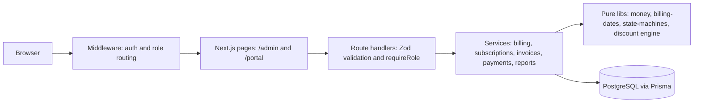
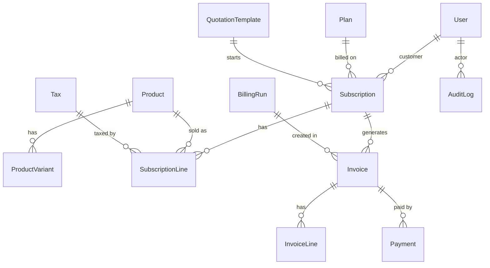

# Brightloop Billing Engine

One platform for the whole life of a subscription business: products and plans, quotations, subscriptions, automated and idempotent invoicing, payments, and a finance dashboard, behind three roles (Admin, Staff, Customer).

Built for the Odoo Hackathon, problem statement "Subscription Management System".

## The problem

Brightloop Software earns money every month but runs on spreadsheets. Renewals get missed, invoices are typed by hand, payments are matched by scrolling bank statements, and nobody can say what the recurring revenue is. This project replaces that with one system where billing day is a single action, and "nothing billed twice or skipped" is guaranteed by the database rather than by discipline.

## Highlights

- **Idempotent billing.** A unique constraint on `Invoice(subscriptionId, periodStart)` plus one transaction per invoice means running billing twice creates no duplicates, even concurrently. If a run crashes halfway, running it again finishes the rest.
- **Integer money.** Every amount is stored as an integer in minor units. All arithmetic goes through one module with half-even rounding, so totals always reconcile exactly.
- **State machines.** Subscription (Draft, Quotation, Confirmed, Active, Paused, Closed) and invoice (Draft, Confirmed, Paid, Cancelled) transitions live in one file, and every legal and illegal transition is tested.
- **Server-side access control.** Roles are enforced in middleware and in every mutating route. Hiding a button is never the only protection.
- **Derived overdue.** Overdue is computed (`dueDate < today` and status Confirmed), never stored, so it can't go stale.
- **Month-end safe dates.** January 31 plus one month is February 28 or 29, not March 3.

## Tech stack

Next.js (App Router, TypeScript strict), Tailwind CSS, shadcn/ui, Prisma 5, PostgreSQL (Neon), Zod, jose (JWT sessions), bcryptjs, date-fns, Recharts, react-hook-form, Resend, Vitest.

## Architecture



Route handlers stay thin. Business rules live in `src/server/services`, and the risky logic (money, dates, discounts, transitions) lives in pure functions in `src/lib`, so it can be unit-tested without a database.

## Data model



Key constraint: `Invoice` is unique on `(subscriptionId, periodStart)`.

## Roles

| Role | Can do |
|---|---|
| Admin | Everything: products, plans, taxes, discounts, templates, staff accounts, billing |
| Staff | Day-to-day work: subscriptions, invoices, payments. Catalog is read-only |
| Customer | Self-service portal: only their own subscriptions and invoices |

Only the admin can create staff accounts. Public signups are always customers.

## Spec coverage

| Scene from the brief | What it does | Status |
|---|---|---|
| A new customer signs up | Unique, case-insensitive email. Password longer than 8 characters with upper, lower and special character, with a live rule checklist | Done |
| Forgotten password | Single-use, hashed, 30-minute reset token sent by email (logged to the console in development) | Done |
| Role-based access | Admin, Staff and Customer routing in middleware, `requireRole` on routes, admin-only staff creation | Done |
| Launching a new plan | Products with variants (Brand: Odoo adds 560), plans billed daily, weekly, monthly or yearly, minimum quantity, availability dates, close/pause/renew toggles | [Done / In progress] |
| Quote to subscription | Quotation templates, numbered subscriptions, Draft to Quotation to Confirmed to Active to Closed with an audit trail | [Done / In progress] |
| Billing day | One-click idempotent billing run with automatic tax and discounts | [Done / In progress] |
| A better price | Admin-only discount rules (fixed or percent, minimums, dates, usage limit) that apply to the next invoice automatically | [Done / In progress] |
| The money comes in | Payments with method, amount, date and note against an invoice, paid vs outstanding | [Done / In progress] |
| Month-end review | Dashboard of active subscriptions, revenue, payments and overdue invoices with filters | [Done / In progress] |

## Getting started

All setup and execution commands should be run from the root directory of the cloned repository.

Requirements: Node 20 or newer and a PostgreSQL database (a free Neon project works).

```bash
git clone https://github.com/sairam0124h/brightloop-billing-engine.git
cd brightloop-billing-engine
npm install
cp .env.example .env     # PowerShell: Copy-Item .env.example .env
# put your database URL in .env, then:
npx prisma migrate deploy
npx prisma generate
npm run seed:admin
npm run dev
```

Open http://localhost:3000.

### Environment variables

| Variable | Purpose |
|---|---|
| `DATABASE_URL` | PostgreSQL connection string |
| `DIRECT_URL` | Direct (non-pooled) connection string used by migrations |
| `JWT_SECRET` | Secret for signing session cookies. Use a long random value |
| `RESEND_API_KEY` | Optional. If empty, emails (reset links, invoices) are logged to the console |
| `APP_URL` | Public base URL, used in email links |
| `JOBS_SECRET` | Secret header for the scheduled billing endpoint |

## Demo credentials

| Role | Email | Password |
|---|---|---|
| Admin | `admin@brightloop.test` | `Admin@12345` |
| Staff | created by the admin at `/admin/staff` | temporary password shown once |
| Customer | sign up at `/signup` | your own |

## Tests

```bash
npm test             # unit tests
npx tsc --noEmit     # type check
npm run build        # production build
```

Covered today: money arithmetic and rounding, billing-date arithmetic including month-end, every subscription and invoice transition, pagination limits, error handling, and the password and reset-token rules. [Add billing idempotency, discount limits and payment tests here once they exist.]

## Design decisions

1. **Idempotency lives in the database.** The unique constraint is the guarantee. Application code only has to treat a unique violation as "already billed", not as an error.
2. **One transaction per invoice.** A failure on one subscription never blocks the others, and a rerun picks up exactly the unbilled periods.
3. **No floats for money.** Integer minor units with half-even rounding, and the invariant `subtotal - discount + tax = total` is tested.
4. **Discounts are evaluated at invoice time.** That is how they appear on the next invoice on their own and stop when they expire or run out, with usage counted inside the same transaction.
5. **Permissions are checked on the server.** Customers are scoped to their own records in the service layer, and the client can never set a role, status, price or total.

## Roadmap

Proration on mid-cycle changes, refunds and credit notes, failed-payment retries and dunning emails, queue-based billing for very large batches, multi-currency, and a revenue forecast.

## Project structure

```
prisma/            schema, migrations, seed scripts
src/app/           pages and route handlers (/admin, /portal, /api)
src/components/    shared UI and shadcn components
src/lib/           money, billing-dates, state-machines, pagination, errors, schemas
src/server/        auth, services
tests/             unit and integration tests
docs/SPEC.md       problem statement
```
